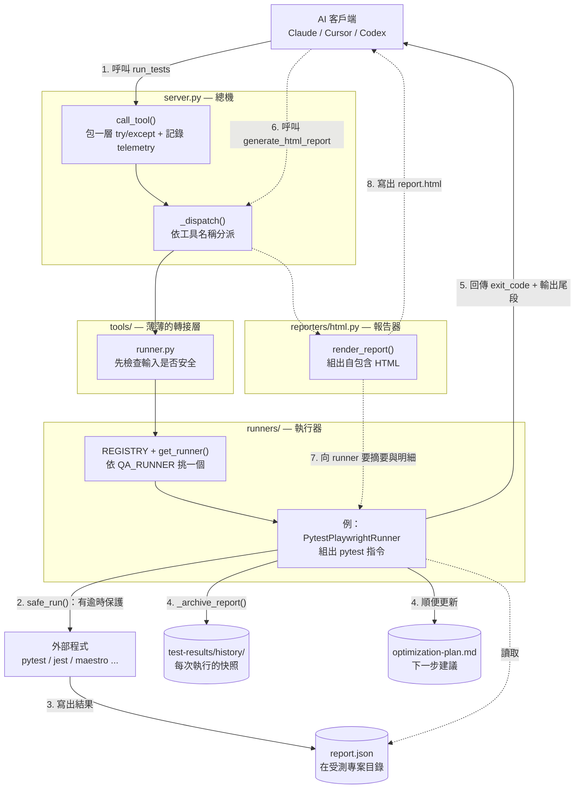
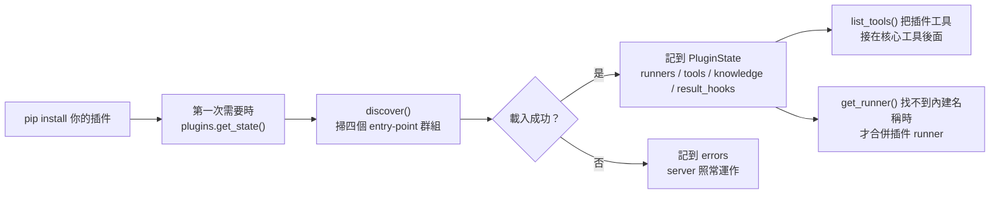

# mk-qa-master 架構導讀（給初學者）

> 依據 v1.5.0（commit `b8e881e`）的程式碼整理。行號以該版本為準。
> 我實際讀了哪些檔案、哪些沒讀，列在[第 4 節](#4-我不確定或沒讀到的地方)。

## 先用一句話理解這個專案

mk-qa-master 是一個「翻譯員」：AI（例如 Claude）說「幫我跑測試」，它把這句話翻成真正的指令（例如 `pytest ...`），跑完再把結果整理成 AI 和人都看得懂的報告。

三個名詞先記住：

| 名詞 | 白話 | 在哪裡 |
|---|---|---|
| **MCP tool（工具）** | AI 可以呼叫的一個「函式」，例如 `run_tests` | `src/mk_qa_master/server.py` |
| **runner（執行器）** | 真正去跑某種測試框架的程式，一種框架一個 | `src/mk_qa_master/runners/` |
| **reporter（報告器）** | 把測試結果畫成 HTML 報告 | `src/mk_qa_master/reporters/html.py` |

---

## 1. 流程圖：AI 呼叫工具 → runner 執行 → reporter 輸出



照著圖走一遍（以預設的 pytest runner 為例）：

1. AI 呼叫 `run_tests`。`call_tool()` 接到後交給 `_dispatch()`（`server.py:1141-1183`）。
2. `_dispatch()` 呼叫 `tools/runner.py` 的 `run_tests()`，這層先用 `validate_filter` 檢查參數（`tools/runner.py:11-14`）。
3. `get_runner()` 依環境變數 `QA_RUNNER` 從 `REGISTRY` 挑出對應的 runner 類別（`runners/__init__.py:46-55`）。
4. runner 組出指令並執行，結果由 pytest 寫進 `report.json`（`runners/pytest_playwright.py:95-123`）。
5. 跑完立刻 `_archive_report()`：把報告複製進 history，並更新 `optimization-plan.md`（`runners/pytest_playwright.py:217-237`）。
6. 之後 AI 呼叫 `generate_html_report`，reporter 不自己讀檔，而是「問 runner」拿摘要和明細，再套進 HTML 樣板（`reporters/html.py:234-341`）。

重點：**reporter 不認識 pytest，也不認識 jest。它只認識 runner 這個介面。** 這就是下面設計亮點 1 的核心。

---

## 2. 插件（plugin）機制

### 插件放哪裡？

**不放在這個 repo 裡。** 插件是一個獨立的 Python 套件，只要和 mk-qa-master 安裝在同一個 Python 環境（同一個 venv）就會被發現。不需要 fork、不需要改 mk-qa-master 的任何檔案。

### 可以擴充哪四種東西？

在插件自己的 `pyproject.toml` 裡宣告 entry point（可以想成「我在這裡，請來找我」的登記表）。四個群組都是選用的，要哪個寫哪個：

| entry-point 群組 | 你要提供什麼 | 效果 |
|---|---|---|
| `mk_qa_master.runners` | 一個繼承 `TestRunner` 的類別 | 可用 `QA_RUNNER=<名稱>` 選到它 |
| `mk_qa_master.tools` | 一個無參數函式，回傳 `list[PluginTool]` | 多出新的 MCP 工具，排在 22 個核心工具之後 |
| `mk_qa_master.knowledge` | 函式 `(lang: str) -> str`，回傳含 `##` 標題的 Markdown | `get_qa_context` 多出知識段落 |
| `mk_qa_master.result_hooks` | 函式 `(event: dict) -> dict \| None` | 每次 `run_tests` / `run_failed` 後被呼叫 |

來源：`src/mk_qa_master/plugins.py:1-38`、`docs/PLUGINS.md`。

### 怎麼被載入？



- 探索只做一次，結果快取在模組變數 `_STATE`（`plugins.py:177-186`）。
- 每個 entry point 的載入都包在 `try/except` 裡，失敗就記進 `errors`，絕不往外拋（`plugins.py:105-174`）。
- 想確認插件有沒有載入成功：呼叫 `get_runner_info`，看回傳的 `plugins.loaded` 與 `plugins.errors`（`server.py:1157-1171`）。
- 總開關：環境變數 `MK_QA_PLUGINS=0` 會完全關閉插件（`plugins.py:92-93`）。

### 最小範例

兩個檔案就夠。

**`hello-plugin/pyproject.toml`**

```toml
[project]
name = "hello-plugin"
version = "0.1.0"
dependencies = ["mk-qa-master>=1.5,<2"]

[project.entry-points."mk_qa_master.runners"]
hello = "hello_plugin:HelloRunner"

[project.entry-points."mk_qa_master.tools"]
hello = "hello_plugin:register_tools"

[project.entry-points."mk_qa_master.knowledge"]
hello = "hello_plugin:knowledge_sections"

[project.entry-points."mk_qa_master.result_hooks"]
hello = "hello_plugin:on_result"

[build-system]
requires = ["hatchling"]
build-backend = "hatchling.build"
```

**`hello-plugin/hello_plugin.py`**

```python
from mk_qa_master.plugins import PluginTool
from mk_qa_master.runners.base import TestRunner


class HelloRunner(TestRunner):
    """六個抽象方法都要實作，少一個就無法建立物件。"""
    name = "hello"

    def list_tests(self) -> str:
        return "test_hello"

    def run_tests(self, filter=None, **kwargs) -> dict:
        return {"exit_code": 0, "stdout_tail": "1 passed"}

    def run_failed(self) -> dict:
        return {"exit_code": 0, "stdout_tail": "nothing to re-run"}

    def get_report_summary(self) -> dict:
        return {"total": 1, "passed": 1, "failed": 0, "skipped": 0, "duration": 0.0}

    def get_failure_details(self, test_id=None) -> list[dict]:
        return []

    def generate_test(self, description: str, filename: str) -> str:
        return "hello runner does not generate tests"


def register_tools() -> list[PluginTool]:
    return [
        PluginTool(
            name="hello_say",                      # 建議加自己的前綴，避免撞名
            description="Say hello to someone.",
            input_schema={
                "type": "object",
                "properties": {"who": {"type": "string"}},
                "required": ["who"],
            },
            handler=lambda args: {"message": f"hello, {args['who']}"},
            # runners=("hello",)  # 加這行的話，只有 QA_RUNNER=hello 時才出現
        )
    ]


def knowledge_sections(lang: str) -> str:
    if lang == "zh-tw":
        return "## Hello 測試守則\n- 先打招呼再測試"
    return "## Hello Testing Rules\n- Say hello before testing"


def on_result(event: dict) -> dict | None:
    # event 內含 tool / runner / result / report_path / project_root
    return {"seen_tool": event["tool"], "runner": event["runner"]}
```

安裝與啟用：

```bash
pip install -e ./hello-plugin     # 裝進和 mk-qa-master 同一個環境
# 然後在 MCP 設定的 env 裡設 QA_RUNNER=hello
```

**這個範例我驗證到什麼程度：** 我把上面的 `hello_plugin.py` 原樣交給真正的 `plugins.discover()` 載入（用手動建立的 entry point，沒有真的 `pip install`），確認了：沒有載入錯誤、工具數從 22 變 23 且 `hello_say` 排在最後、呼叫 `hello_say` 得到 `{"message": "hello, Dora"}`、`get_runner_info` 的 current 是 `hello`、`run_tests` 的回傳多了 `result_hooks`、知識段落有被串接。**沒驗證的部分**是 `pyproject.toml` 經過 `pip install` 後的實際探索流程，那份 toml 是依 `docs/PLUGINS.md` 的格式寫的。

### 三條保護規則

1. 插件 runner 不能蓋掉內建名稱（`pytest`、`maestro` 等），撞名會被忽略並記錄（`plugins.py:137-139`、`runners/__init__.py:43`）。
2. 插件工具不能和核心工具或其他插件工具同名（`plugins.py:155-158`、`server.py:35-40`）。
3. result hook 丟例外不會讓測試執行失敗，只會在該 hook 的結果列標成 `ok: false`（`plugins.py:215-224`）。

---

## 3. 設計亮點

### 亮點 1：用「介面 + 登記表」支援多種測試框架

- `src/mk_qa_master/runners/base.py:4-43` — `TestRunner` 抽象類別
- `src/mk_qa_master/runners/__init__.py:12-30` — `REGISTRY` 字典
- `src/mk_qa_master/runners/__init__.py:46-55` — `get_runner()`

`TestRunner` 規定每個 runner 都要有同樣的六個方法。`REGISTRY` 是一個「名稱 → 類別」的字典，`get_runner()` 查表後建立物件。

**為什麼好：** 專案其他部分（server、reporter、optimizer）只跟 `TestRunner` 講話，不需要寫 `if 是 pytest ... elif 是 jest ...`。要支援新框架，只要新增一個類別並在字典加一行。同一個類別可以有多個別名（`"pytest"`、`"playwright"` 都指向同一個），使用者怎麼打都對。

另外注意 `base.py:27-43`：`codegen`、`get_history`、`get_all_test_details` 不是抽象方法，而是有預設實作（回傳空值或「不支援」）。這讓簡單的 runner 可以少寫，功能自然「降級」而不是當掉。

### 亮點 2：所有工具呼叫都經過同一個「安全網」

- `src/mk_qa_master/server.py:1141-1153` — `call_tool()`

```python
try:
    return await _dispatch(name, args)
except Exception as e:
    err_type = type(e).__name__
    return [TextContent(type="text", text=f"執行錯誤: {err_type}: {e}")]
finally:
    telemetry.log_tool_call(name, args or {}, int((time.time() - started) * 1000), err_type)
```

**為什麼好：**

- 任何工具出錯都變成一段文字回給 AI，而不是讓整個 server 掛掉。AI 看得到錯誤訊息，可以自己調整後重試。
- `finally` 保證不論成功失敗都會記錄一筆使用紀錄（工具名、耗時、錯誤類型）。這些紀錄後來被 optimizer 拿來分析「哪個工具常出錯」。
- 記錄本身也不會害到主流程：`tools/telemetry.py:31-37` 寫檔失敗就默默略過。另外它只存參數的雜湊值（`telemetry.py:45`），不存參數原文。

初學者可以學到的模式：**把「每個呼叫都要做的事」集中在一個入口**，不要在二十幾個工具裡各寫一次。

### 亮點 3：把 AI 傳來的參數當成不可信輸入

- `src/mk_qa_master/security.py:36-68` — `validate_filter()`
- `src/mk_qa_master/security.py:71-95` — `validate_filename()`
- `src/mk_qa_master/security.py:98-131` — `safe_run()`
- 使用處：`tools/runner.py:11-13`、`tools/generator.py:21-23`

工具的參數來自 AI 解讀自然語言的結果，有可能被惡意內容誘導。這裡擋了兩種具體攻擊：

- **參數注入**：`filter` 若以 `-` 開頭會被拒絕，否則 `--config=/tmp/evil` 會被 pytest 當成選項。
- **路徑穿越**：`filename` 會先解析成絕對路徑，再確認仍在專案目錄內，否則 `../../etc/passwd` 可以寫到任何地方。

`safe_run()` 則替所有外部指令加上逾時（預設 600 秒）。逾時時它不丟例外，而是回傳一個 `returncode=124` 的假結果。

**為什麼好：** 檢查集中在一個模組，而且放在「邊界」（資料剛進來的地方）。呼叫端也因此簡單：不必到處寫 `try/except TimeoutExpired`，只要看結束代碼。檔案開頭的註解（`security.py:1-18`）還說明了哪些攻擊「不在範圍內」以及原因，這種寫法值得學。

### 亮點 4：插件壞掉不會拖垮主程式，沒裝插件時行為完全不變

- `src/mk_qa_master/plugins.py:105-174` — `discover()`，每一步都有 `try/except`
- `src/mk_qa_master/server.py:20-28` — 插件工具永遠接在核心工具「後面」
- `src/mk_qa_master/server.py:1166-1170` — 有插件時才多回傳 `plugins` 欄位
- `src/mk_qa_master/tools/runner.py:55-56` — 沒有 hook 時不加 `result_hooks` 欄位

**為什麼好：** 這個專案對外承諾 22 個核心工具的規格不變（由 `tests/snapshots/v1/tool_surface.json` 把關）。開放擴充通常會威脅這種承諾，這裡的做法是：插件只能「往後加」、不能「蓋掉」，而且沒裝插件的人拿到的回應和以前一模一樣。別人寫的爛插件也只會變成 `errors` 清單裡的一筆，不會讓使用者的 server 開不起來。

### 亮點 5：跑完測試自動存檔並產生建議，不靠使用者記得

- `src/mk_qa_master/runners/pytest_playwright.py:217-237` — `_archive_report()`
- 呼叫處：同檔 `:123`（`run_tests`）與 `:134`（`run_failed`）

每次執行後自動做兩件事：把 `report.json` 以時間戳記複製到 history、重新產生 `optimization-plan.md`。兩步都包在 `try/except` 裡，註解寫明「optimizer 失敗絕不該擋住測試執行」。

**為什麼好：** 歷史資料要連續才有價值（才算得出「這個測試時好時壞」）。把存檔掛在執行流程裡，就不會因為誰忘了多呼叫一步而斷掉。同時它把「主要功能」（跑測試）和「加值功能」（分析）的失敗隔開，加值功能壞了主要功能照常運作。

### 順帶一提：`config.py` 的兩種讀設定方式

- `src/mk_qa_master/config.py:6-18` — 模組載入時讀一次，存成常數（`PROJECT_ROOT`、`RUNNER_NAME`）
- `src/mk_qa_master/config.py:203-280` — `EdgeConfig` 用 `@property`，每次存取都重新讀環境變數

類別的說明文字（`config.py:204-209`）解釋了原因：這樣測試只要改環境變數就立刻生效，不用重新載入模組。同一個檔案裡兩種風格並存，是不同時期的取捨，可以拿來問作者（見第 5 節）。

---

## 4. 我不確定或沒讀到的地方

### 沒有完整讀的檔案

| 檔案 | 讀了什麼 | 沒讀什麼 |
|---|---|---|
| `src/mk_qa_master/server.py`（1516 行） | 1-71、1096-1245、1385-1400、1480-1516 行，加上全檔的函式與分派清單 | 72-1095 行（22 個工具的規格定義）與 1245-1385 行（後半工具的分派）沒有逐行讀 |
| `src/mk_qa_master/runners/pytest_playwright.py`（505 行） | 1-14、40-42、86-245 行 | 245 行之後：步驟擷取、歷史讀取、測試樣板產生 |
| `src/mk_qa_master/reporters/html.py`（774 行） | 1-66、232-343 行 | 中間的小元件函式、344 行之後的 HTML/CSS 樣板 |
| `README.zh-TW.md`（735 行） | 22-106、270-519 行，其餘只看了標題 | API 測試、視覺挑戰、Prompting cookbook、範本輸出等段落的內文 |
| `skills/mk-qa-master/` | `SKILL.md`、`reference/tool-surface.md`、`reference/wire-mcp.md`、`commands/run-tests.md` 全文 | `reference/workflow.md` 只讀前 60 行；`commands/generate.md`、`commands/api-security.md` 只讀前 25 行 |

完整讀過的：`config.py`、`plugins.py`、`docs/PLUGINS.md`、`runners/__init__.py`、`runners/base.py`、`tools/runner.py`、`tools/generator.py`、`tools/reporter.py`、`tools/telemetry.py`、`resources/reports.py`。

`tools/` 我選的代表是 `runner.py`（轉接層）和 `telemetry.py`。`analyzer.py`、`optimizer.py`、`qa_context.py`、`qa_plan.py`、`visual_challenge.py` 都沒有讀內容，所以本文對 optimizer「怎麼算出建議」、`qa_plan`「怎麼比對證據」沒有任何說明。除了 pytest 以外的 runner 也都沒讀，流程圖中「每個 runner 都寫出同樣格式的 `report.json`」這件事，我只在 pytest runner 親眼確認，其餘是依 README 的說法。

### 文件和程式碼對不上的地方

以下是我讀到的不一致。哪一邊才是作者的本意我不知道，只列出事實：

1. **`SKILL.md` 引用了不存在的檔案。** 第 161 行提到 `reference/captcha-solver.md`、第 202 行提到 `reference/api-security-deep.md`，但 `reference/` 目錄只有 `tool-surface.md`、`wire-mcp.md`、`workflow.md` 三個檔案。
2. **參數名稱不同。** `SKILL.md:116` 寫 `get_failure_details(test_name="...")`，但 `server.py:1194` 讀的是 `args.get("test_id")`。
3. **報告路徑不同。** `reference/tool-surface.md` 寫報告在 `test-results/report.json`、HTML 寫到 `test-results/report.html`；程式碼是 `PROJECT_ROOT / "report.json"`（`config.py:10`）與 `PROJECT_ROOT / output`（`reporters/html.py:338`）。
4. **預設值不同。** `tool-surface.md` 寫 `QA_PROJECT_ROOT` 預設是 CWD；`config.py:6` 的預設是 `./tests_project`。
5. **CLI 備援指令可能跑不動。** `wire-mcp.md` 用了 `from mk_qa_master.tools.reporter import generate_html`，但 `tools/reporter.py` 只有三個函式，沒有這個名稱。`tool-surface.md` 的 `python -m mk_qa_master.tools.runner list_tests` 也一樣可疑：`tools/runner.py` 沒有 `__main__` 區塊。我沒有實際執行這些指令。
6. **版本號過時。** `SKILL.md:41` 與 `wire-mcp.md` 寫 `pip install mk-qa-master==0.9.0`，目前是 1.5.0。
7. **`README.zh-TW.md` 落後英文版。** 從標題看，中文版沒有英文版的 OWASP API 安全掃描、Skill 安裝、穩定性承諾、Edge AI Runner、plan/verify bookend、`doctor` 等章節；第 35 行仍把你說已過時的 `docs/framework.md` 稱為「完整設計文件」。
8. **`README.zh-TW.md:409` 說 `report://json` 是「原始 pytest-json-report JSON」，`server.py:1111` 的描述卻是「各 runner 的原生格式」。** 兩者哪個準確，要讀其他 runner 才知道。

### 看起來沒在用、但我不敢斷定的程式碼

- `src/mk_qa_master/resources/reports.py`：我在 `src/` 裡搜尋不到任何地方 import 它，它提到的 `report://latest`、`trace://` 也不在 `server.py:1098-1120` 註冊的三個資源裡。可能是早期遺留，也可能有我沒看到的用途（例如給外部使用）。
- `reporters/html.py:240` 與 `:303` 用 `hasattr(runner, "get_all_test_details")` 檢查，但 `base.py:30-43` 已經替所有 runner 提供預設實作，這個檢查對繼承 `TestRunner` 的類別應該永遠為真。可能是歷史遺留的防禦寫法。

### 其他不確定

- 我不知道 `server.py` 為什麼選擇用一長串 `if name == ...` 而不是字典分派。這是事實描述，不是批評；原因只能問作者。
- 流程圖把「AI 取得 HTML 報告」畫成呼叫 `generate_html_report`。另一條路是讀 MCP 資源 `report://html`（`server.py:1126-1127`），兩者最後都呼叫 `render_report()`，圖上為了簡潔沒有畫出第二條。

---

## 5. 可以請教原作者的 5 個問題

1. **`server.py` 的結構取捨。** 22 個工具的規格和分派都寫在同一個 1500 行的檔案裡，用 `if name == ...` 逐一比對。這是為了讓「凍結的工具介面」集中在一處方便審查，還是單純隨版本長出來的？如果重來，會考慮讓每個工具自己註冊（像插件的 `PluginTool` 那樣）嗎？

2. **設定什麼時候讀。** `config.py` 的 `PROJECT_ROOT`、`RUNNER_NAME` 在 import 時就固定，`EdgeConfig` 卻改成每次存取都重讀環境變數，理由是測試比較好寫。舊的常數有打算也改成這種方式嗎？還是有「一個行程只服務一個 runner」這類刻意的限制？

3. **`report.json` 這份「共同格式」有沒有正式規格？** reporter、history、optimizer、`verify_plan` 都依賴它，插件文件也建議繼承 `PytestPlaywrightRunner` 來重用解析邏輯。如果我想從零寫一個 runner，哪些欄位是必要的？v1.3.1 修的 edge runner 報告問題，是不是就是因為這份格式沒有明文規定？

4. **文件該以哪個為準。** `skills/` 下的文件和程式碼有幾處對不上（第 4 節列的參數名 `test_name` / `test_id`、報告路徑、兩個不存在的 reference 檔）。`tests/test_v1_doc_sync.py` 目前檢查工具數量和名稱，有計畫把參數名稱和檔案連結也納入檢查嗎？中文 README 之後會繼續和英文版同步嗎？

5. **插件 API 的穩定性承諾到哪裡。** 核心 22 個工具有 v1 凍結保證，那 `TestRunner` 的六個抽象方法、`PluginTool` 的欄位、result hook 的 `event` 內容，算不算同一份承諾的一部分？例如未來 `TestRunner` 若新增抽象方法，現有的第三方 runner 就會無法建立物件，這種情況會怎麼處理？
