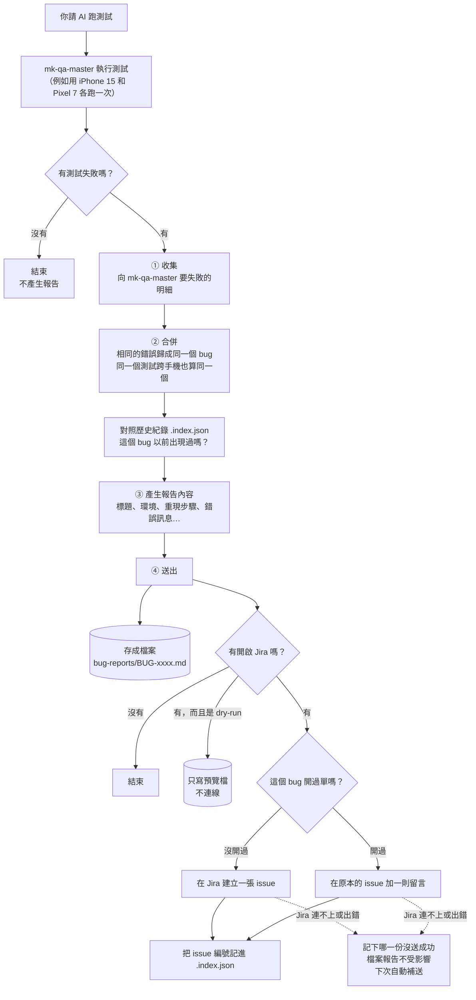

# 我在這個分支做了什麼

這份文件說明 `feature/bug-report` 分支在師父原本的 mk-qa-master 專案上**多做了哪些東西**、每一項**驗證到什麼程度**，以及之後想自己動手改可以從哪裡開始。寫給完全不懂程式的人。

- 原始專案：mk-qa-master v1.5.0（讓 AI 幫忙跑測試的工具）
- 這個分支沒有修改 `src/mk_qa_master/`（師父的程式本體）。所有新增的東西都放在旁邊的資料夾。
- 所有驗證都在**同一台 Windows 11 電腦**上進行，日期是 2026-11-17。

## 目錄

1. [多做了什麼](#1-多做了什麼)
2. [發現的三個問題](#2-發現的三個問題)
3. [流程圖：從測試失敗到 bug 報告](#3-流程圖從測試失敗到-bug-報告)
4. [想自己動手改：五個小練習](#4-想自己動手改五個小練習)
5. [還沒做的事與建議做法](#5-還沒做的事與建議做法)

---

## 1. 多做了什麼

「驗證程度」分三種：

| 標記 | 意思 |
|---|---|
| **實測過** | 當天真的執行過，並看到預期的結果 |
| **只用 mock** | 用「假的對象」測過（例如假的 Jira），沒有碰過真的 |
| **未驗證** | 沒有執行過，只是依文件或推論寫的 |

### 功能

| 做了什麼 | 放在哪裡 | 驗證程度 |
|---|---|---|
| **bug 報告插件**：測試失敗後，自動把每個失敗整理成一份 Markdown 報告（標題、嚴重度、環境、重現步驟、預期／實際結果、錯誤訊息、截圖路徑） | `plugins/mk-qa-bug-reporter/` | **實測過**。真的安裝插件、透過 MCP 呼叫 `run_tests`、看到報告檔產生。注意：是用 Python 寫的測試用戶端加上 Windows 繞過方式跑的（見下方「共同的但書」） |
| 相同錯誤合併成一份報告；同一個錯誤下次再出現時更新原報告而不重開 | 同上（`grouping.py`、`store.py`） | **實測過**。連跑兩次，確認檔案數不變、出現次數 +1 |
| 報告標示手機裝置；同一個測試在不同手機上的相同錯誤合併成一份 | 同上（`devices.py`） | **實測過**。用手機範例跑，2 個失敗只產生 1 份報告，內含兩支手機 |
| 報告的 Markdown「可以直接貼進 Jira」 | 同上（`render.py`） | **未驗證**。格式是標準 Markdown，但沒有實際貼進 Jira 試過 |
| **送到 Jira**：第一次出現自動開單，再次出現改成留言 | 同上（`jira.py`、`adf.py`） | **只用 mock**。從未連過真正的 Jira。用假的 Jira 和只在本機運作的假伺服器測過 |
| Jira 的 dry-run 模式（只預覽、不送出） | 同上 | **實測過**。透過 MCP 跑過，確認沒有連線、有產生預覽檔、輸出裡沒有 token。這項本來就不連 Jira，所以可以實測 |
| API token 不外洩（不寫進檔案、不出現在錯誤訊息） | 同上 | **只用 mock**。自動化測試會故意讓錯誤訊息夾帶假 token 來檢查；另外用假 token 透過 MCP 跑過一次 dry-run 確認。沒有用真的 token 測過 |
| **手機 H5 測試範例**：讓網頁測試用 iPhone 15 和 Pixel 7 的樣子各跑一次 | `examples/mobile-h5/` | **實測過**。直接執行和透過 MCP 都跑過，結果是 2 通過、2 失敗（失敗是故意的）。只用 Chromium 引擎測過 |
| 手機清單加上桌面版、裝置名稱打錯時的提示 | `examples/mobile-h5/conftest.py` | **實測過**。在複製出來的副本上試的 |
| **Windows 啟動檔**：繞過 Windows 上「跑測試會卡住」的問題 | `examples/mobile-h5/start_server_windows.py` | **實測過**，但只用 Python 寫的測試用戶端。用在 Claude Desktop、Cursor 等真正的 AI 客戶端：**未驗證** |
| 示範腳本：模擬 AI 呼叫 `run_tests` | `plugins/mk-qa-bug-reporter/examples/demo_via_mcp.py` | **實測過** |

### 文件

| 做了什麼 | 放在哪裡 | 驗證程度 |
|---|---|---|
| 給 AI 助手看的專案說明（常用指令、架構、規則） | `CLAUDE.md` | 跑測試的指令（全部、單一檔案、用關鍵字篩選）**實測過**。`mk-qa-master doctor` **實測過**，結果是在這台 Windows 上會當掉，要加 `PYTHONUTF8=1` 才正常（見第 2 節最後）。安裝額外功能的指令（`.[api]`、`.[edge]`）：**未驗證**。架構說明是讀程式碼整理的，其中較大的檔案只讀了一部分 |
| 給初學者的架構導讀 | `ARCHITECTURE_INSIGHTS.md` | 讀程式碼整理的；第 4 節列出了沒讀到的範圍。裡面的「最小插件範例」用真正的插件載入器試過，但**沒有**實際 `pip install` 那個範例 |
| 三份 bug 報告 | `docs/bug-reports/` | 見[第 2 節](#2-發現的三個問題) |
| 插件的使用說明與 Jira 教學 | `plugins/mk-qa-bug-reporter/README.md` | dry-run 那一步的指令**實測過**（用假的帳號與假 token）。「正式啟用」那一步：**未驗證**（需要真的 Jira）。PowerShell 設定 token 的寫法，只在 PowerShell 7 用假資料試過「轉換」那一行；要你手動貼上 token 的那一步、舊版 Windows PowerShell 5.1、Atlassian 網頁的操作步驟：**未驗證** |
| 手機 H5 範例的說明 | `examples/mobile-h5/README.md` | 方法一（直接執行）與方法三（示範腳本）**實測過**。方法二（請 AI 執行）：**未驗證**，我只用 Python 測試用戶端搭配 Windows 啟動檔跑過同樣的流程，沒有用真正的 AI 客戶端 |

### 自動化測試

| 項目 | 結果 |
|---|---|
| 插件自己的測試 | 98 個全部通過（**實測過**） |
| 師父原本的測試 | 22 個失敗、467 個通過。這 22 個失敗在我做任何事之前就存在：21 個來自第 2 節的第 1 個問題（Windows 檔案路徑），1 個來自 Windows 的文字編碼。我的改動沒有讓它變好或變壞（**實測過**，每次改動後都重跑） |

### 共同的但書

下面幾點適用於上表所有「實測過」的項目：

- **只在 Windows 11 測過。** macOS、Linux 都沒試。
- **沒有用真正的 AI 客戶端測過。** 所有「透過 MCP」的測試，都是用一支 Python 小程式假裝成 AI 來呼叫。Claude Desktop、Cursor、Claude Code 實際使用時是否相同：未驗證。
- **在這台 Windows 上，一定要用繞過方式才跑得動。** 不繞過的話 `run_tests` 會卡住（第 2 節的第 2 個問題）。所以嚴格來說，「mk-qa-master 原封不動 + 這個插件」在 Windows 上沒有成功跑過。
- **只用 Chromium 瀏覽器引擎測過。**

---

## 2. 發現的三個問題

這三個都是 mk-qa-master 原本就有的問題，不是這個分支造成的。我只寫了報告，沒有修改師父的程式。

| # | 一句話摘要 | 報告 |
|---|---|---|
| 1 | 在 Windows 上，用本機檔案路徑（像 `C:\...`）指定 API 規格檔時，安全掃描功能讀不到檔案，因為程式把磁碟代號 `C:` 誤認成網址的一部分。 | [windows-file-url.md](docs/bug-reports/windows-file-url.md) |
| 2 | 在 Windows 上透過 AI 跑測試會卡住不動、等到逾時（預設 10 分鐘）才結束且沒有結果，原因是測試程式接到了不該接的輸入管線；做了四組對照實驗確認。 | [windows-run-tests-stdin-hang.md](docs/bug-reports/windows-run-tests-stdin-hang.md) |
| 3 | 給 AI 看的操作手冊有八處和程式實際行為對不上，例如參數名稱寫錯、引用了不存在的檔案、中文版說明比英文版少了好幾章。 | [docs-code-mismatch.md](docs/bug-reports/docs-code-mismatch.md) |

它們和第 1 節的關係：

- 第 1 個問題造成「師父原本的測試有 22 個失敗」當中的 21 個。
- 第 2 個問題是「Windows 上必須用繞過方式才跑得動」的原因。

### 另外兩個還沒寫成報告的 Windows 編碼問題

這台電腦的 Windows 預設文字編碼是 cp950（繁體中文 Big5），不是 UTF-8。這造成兩個小問題，目前只記在 `CLAUDE.md`，沒有獨立的報告：

- **`mk-qa-master doctor` 會當掉。** 這是寫這份文件做最後檢查時才發現的。把它的輸出存成檔案或接給其他程式時，會出現 `UnicodeEncodeError`（它要印 `✓`、`≥` 這類符號，cp950 沒有）。加上 `PYTHONUTF8=1` 這個設定後就正常。直接在終端機視窗裡看（不存檔、不轉接）時會不會當掉：未驗證。
- **師父的測試有 1 個因此失敗**（上面 22 個裡的最後 1 個），同樣加上 `PYTHONUTF8=1` 就會通過。

---

## 3. 流程圖：從測試失敗到 bug 報告



重點：

- 存成檔案這一步永遠會做（只要設定裡保留 `file`）。Jira 是額外的。
- Jira 出任何問題都不會讓測試失敗，也不會讓檔案報告消失。
- 「這是不是同一個 bug」只看這台電腦上的 `.index.json`。換一台電腦或刪掉這個檔案，插件就不記得以前的事。

---

## 4. 想自己動手改：五個小練習

從最簡單到比較難。每個練習都寫了：改哪個檔案的哪裡、改完怎麼確認有效。

**這五個練習的改法我都實際做過一遍**，下面寫的數字（幾個通過、幾個失敗、哪個測試失敗）是真的跑出來的。但要說明我是怎麼確認的：

- 練習 1：在複製出來的副本上改，直接執行 `pytest`。
- 練習 2：用示範腳本實際跑，打開報告確認。我是用另一種終端機（bash）設定環境變數的；PowerShell 的 `$env:名稱 = "值"` 這種寫法另外確認過可用。
- 練習 3、4、5：在複製出來的插件副本上改，跑插件測試，並直接呼叫產生報告的程式來看結果。**沒有**在改過的版本上跑示範腳本，所以這三個練習裡「跑示範後打開報告會看到…」那一步是依程式行為推定的，數字與失敗的測試名稱則是實際跑出來的。
- 練習 5 裡 `summary.txt` 的範例內容是示意，實際的時間與標題會不同。

開始前的準備（只要做一次），在 mk-qa-master 資料夾裡執行：

```powershell
pip install -e .
pip install -e plugins/mk-qa-bug-reporter
playwright install chromium
```

下面會反覆用到兩個指令：

- **「跑插件測試」**：
  ```powershell
  cd plugins/mk-qa-bug-reporter
  pytest tests
  cd ../..
  ```
  沒改任何東西時，最後一行是 `98 passed`。
- **「跑示範」**（Windows）：
  ```powershell
  python plugins/mk-qa-bug-reporter/examples/demo_via_mcp.py examples/mobile-h5 --isolate-stdin
  ```
  跑完後打開 `examples/mobile-h5/bug-reports/` 裡的 `.md` 檔看報告。

改錯了不用怕：用 `git diff` 可以看自己改了什麼，用 `git checkout -- 檔案路徑` 可以把那個檔案還原成改之前的樣子。

### 練習 1（最簡單）：多測一支桌面版

**改哪裡：** `examples/mobile-h5/conftest.py` 最上面的 `DEVICES` 清單，加一行：

```python
DEVICES = [
    "iPhone 15",
    "Pixel 7",
    "Desktop Chrome",
]
```

**怎麼確認：**

```powershell
cd examples/mobile-h5
pytest
cd ../..
```

原本最後一行是 `2 failed, 2 passed`，改完變成 **`2 failed, 4 passed`**。多出來的兩個是桌面版，而且都通過，因為那張 800 寬的表格在 1280 寬的桌面螢幕上不會超出去。

**學到什麼：** 設定檔裡的一個清單，就能決定每個測試要跑幾種裝置。

### 練習 2：不改程式，改報告的嚴重度

**改哪裡：** 不用改任何檔案。在 PowerShell 設定一個環境變數：

```powershell
$env:QA_BUG_REPORT_SEVERITY = "High"
```

**怎麼確認：** 在同一個 PowerShell 視窗「跑示範」，打開報告，摘要表會從 `| 嚴重度 | Medium |` 變成 **`| 嚴重度 | High |`**。

改回來：`Remove-Item Env:QA_BUG_REPORT_SEVERITY`，再跑一次示範。

**學到什麼：** 很多行為可以用「環境變數」調整，不需要動程式。有哪些可以調，看 `plugins/mk-qa-bug-reporter/mk_qa_bug_reporter/settings.py` 最上面的表格。

### 練習 3：改報告裡的段落標題

**改哪裡：** `plugins/mk-qa-bug-reporter/mk_qa_bug_reporter/render.py`，找到 `LABELS` 這個區塊裡的這一行：

```python
    "steps": "重現步驟",
```

改成：

```python
    "steps": "Steps to Reproduce",
```

**怎麼確認：**

1. 「跑示範」，打開報告，`## 重現步驟` 變成 `## Steps to Reproduce`。
2. 「跑插件測試」，這次會看到 **`2 failed, 96 passed`**。失敗的是：
   - `test_markdown_has_every_required_section`
   - `test_adf_structure_of_a_real_report`

   這不是你改壞了。這兩個測試的工作是「檢查報告裡有沒有『重現步驟』這幾個字」，你把字改掉了，它們當然會抗議。
3. 打開 `tests/test_bugreporter_units.py` 和 `tests/test_bugreporter_jira.py`，搜尋 `重現步驟`，把它們也改成 `Steps to Reproduce`，再跑一次測試，回到 `98 passed`。

**學到什麼：** 測試是在保護「現在的行為」。你故意改了行為，就要連測試一起改。測試失敗時先看它在檢查什麼，再判斷是程式錯還是測試該更新。

### 練習 4：在報告最後加一個新段落

**改哪裡：** 同一個檔案 `render.py`，要改三個地方。

**第一處**：找到 `_SECTIONS: dict[str, Callable[[BugReport], str]] = {` 這一行，在它的**上面**加一個新函式：

```python
def _section_note(report: BugReport) -> str:
    return "## 備註\n\n這份報告由程式自動產生，送出前請人工確認。"


```

**第二處**：在 `_SECTIONS` 的大括號裡，最後一項 `"affected": _section_affected,` 的下面加一行：

```python
    "note": _section_note,
```

**第三處**：往上找到 `SECTION_ORDER` 清單，在最後一項 `"affected",` 的下面加一行：

```python
    "note",
```

**怎麼確認：**

1. 「跑示範」，打開報告，最下面多了「## 備註」和那句話。
2. 「跑插件測試」，會看到 **`1 failed, 97 passed`**，失敗的是 `test_adf_structure_of_a_real_report`。它檢查的是「報告有哪些段落」的完整清單，你多加了一個，所以要到 `tests/test_bugreporter_jira.py` 把 `"備註"` 加進那個測試的 `headings` 清單最後面。

**學到什麼：** 報告是由一個個「段落函式」組成的。每個函式拿到一份 bug 的資料（`report`），回傳一段文字。`SECTION_ORDER` 決定順序。想在段落裡用到 bug 的資料，可以參考其他 `_section_xxx` 函式怎麼寫（例如 `report.severity`、`report.devices`）。

### 練習 5（較難）：新增一個送出管道

目標：除了每個 bug 一份報告，另外把所有 bug 的標題累積寫進一個 `summary.txt`，一行一個。

**改哪裡：** `plugins/mk-qa-bug-reporter/mk_qa_bug_reporter/submitters.py`，要改兩個地方。

**第一處**：找到 `# 名稱 → 類別。` 這行註解，在它的**上面**加：

```python
class SummarySubmitter(Submitter):
    """把每份報告的標題寫成一行，累加到 summary.txt。"""

    name = "summary"

    def __init__(self, output_dir: Path):
        self.output_dir = Path(output_dir)

    @classmethod
    def from_settings(cls, settings: Settings) -> "SummarySubmitter":
        return cls(settings.output_dir)

    def submit(self, report: BugReport, markdown: str) -> SubmitResult:
        self.output_dir.mkdir(parents=True, exist_ok=True)
        path = self.output_dir / "summary.txt"
        with path.open("a", encoding="utf-8") as f:
            f.write(f"{report.last_seen} {report.bug_id} {report.title}\n")
        return SubmitResult(ok=True, ref=str(path))


```

**第二處**：在下面的 `SUBMITTERS` 字典裡，`"jira": JiraSubmitter,` 的下面加一行：

```python
    "summary": SummarySubmitter,
```

**怎麼確認：**

1. 「跑插件測試」，應該仍然全部通過（如果你還留著練習 4 的改動而沒更新測試，會有那 1 個失敗，和這個練習無關）。
2. 開啟新的管道，然後「跑示範」：
   ```powershell
   $env:QA_BUG_REPORT_SUBMITTERS = "file,summary"
   ```
3. 畫面輸出的 `"submitted"` 裡會同時有 `"file"` 和 `"summary"`。
4. `examples/mobile-h5/bug-reports/` 裡多了 `summary.txt`，內容像這樣：
   ```
   2026-11-17T14:29:09 BUG-3b0a6fd8 [test_no_horizontal_scroll[chromium]] AssertionError: ...（2 個裝置）
   ```
   再跑一次，會多一行。

改回來：`$env:QA_BUG_REPORT_SUBMITTERS = "file"`。

**學到什麼：** 這就是 Jira 功能加進來的方式。「送出管道」只要做到一件事：有一個 `submit(report, markdown)`，回傳成功或失敗。收集、合併、產生報告那三步完全不用動。想看一個完整的例子，讀 `jira.py`。

**延伸挑戰：** 為 `SummarySubmitter` 寫一個測試。可以參考 `tests/test_bugreporter_units.py` 裡的 `test_file_submitter_writes_markdown`。

---

## 5. 還沒做的事與建議做法

以下的「建議做法」都是**方向上的建議，沒有實際做過**，動手時可能會遇到我沒預料到的狀況。

### 5.1 連真的 Jira 驗證

**現況：** Jira 功能只用假的 Jira 測過。最可能出問題的是 Jira 是否接受插件送出的內容格式。

**建議做法：**

1. 在 Jira 開一個**專門測試用的專案**，不要用正式專案。
2. 照 `plugins/mk-qa-bug-reporter/README.md` 第 5 節的四個步驟做，先 dry-run、再正式啟用。
3. 逐項確認，並記下結果：
   - 第一次執行有沒有成功開單？單子的標題、內文、標籤對不對？
   - 內文的標題、清單、程式碼區塊在 Jira 上有沒有正常顯示？
   - 再跑一次，是不是變成留言而不是多一張單？
   - 故意把專案代碼打錯，錯誤訊息看不看得懂？
   - 把報告的 `.md` 檔內容整段貼進 Jira 的編輯器，格式會不會跑掉？（這是另一個未驗證的項目）
4. 如果開單失敗並回傳 `HTTP 400`，把錯誤訊息裡的欄位名稱記下來，那就是要修的地方（多半在 `adf.py` 或 `jira.py` 的 `issue_fields()`）。

### 5.2 Jira 上傳截圖

**現況：** issue 裡只有截圖在你電腦上的路徑，別人看不到圖。

**建議做法：** Jira 有專門上傳附件的功能，是在開單**之後**另外呼叫一次。可以在 `jira.py`：

- `JiraClient` 加一個 `add_attachment(issue_key, 檔案路徑)`。
- `JiraSubmitter._submit()` 在開單成功後，對每個失敗測試的 `screenshot` 逐一上傳。
- 上傳失敗只記錄、不影響開單結果（和現在的原則一致）。
- 影片和 trace 檔案比較大，建議先只傳截圖，或加一個檔案大小上限。
- 留言的情況（bug 再次出現）要不要也傳新截圖，需要先決定，否則同一張單會累積很多重複的圖。

這項和 5.1 一樣，沒有真的 Jira 就無法確認做對了，建議在 5.1 之後做。

### 5.3 test case 文件匯出

**現況：** 沒有做。目前只有「失敗」的測試會被整理成報告。

**建議做法：** 目標是把「所有測試」整理成一份測試案例清單（名稱、說明、最近一次結果）。資料來源和 bug 報告相同：`collector.py` 裡向 mk-qa-master 要的那份明細，本來就包含通過的測試，只是現在被過濾掉了。兩種做法：

- **簡單版**：仿照練習 5，新增一個送出管道。但它是「每個 bug 呼叫一次」，拿不到通過的測試，不太適合。
- **比較合適的做法**：在 `hook.py` 的 `process()` 裡，另外呼叫一個新函式，把全部測試（不只失敗的）寫成 `test-cases.md` 或 `.csv`。測試的「說明」來自測試函式的 docstring（就是 `"""..."""` 裡的那句話），沒寫的話就只有名稱。

要先想清楚格式：給誰看？要匯入哪個系統？如果是要匯入測試管理工具，各家要的欄位不同。

### 5.4 Android 模擬器實測手機 App

**現況：** 完全沒碰。這個分支做的「手機 H5」是**手機瀏覽器裡的網頁**，不是手機 App。

**建議做法：** mk-qa-master 本身支援用 Maestro 這個工具測手機 App（設定 `QA_RUNNER=maestro`）。要試的話需要：

1. 安裝 Android Studio，建立並啟動一台模擬器。
2. 安裝 Maestro。
3. 準備一個要測的 App（`.apk`）裝進模擬器。
4. 照師父 `README.md` 裡 Maestro 的段落設定。

要留意的地方：

- 第 2 節的第 2 個問題（Windows 上跑測試會卡住）**很可能同樣會發生**，因為 Maestro 也是走同一段程式啟動的。可能同樣需要 `start_server_windows.py`。這是推測，沒有試過。
- bug 報告插件對 Maestro 的失敗能不能正常產生報告、附件路徑抓不抓得到：未驗證。
- Maestro 官方對 Windows 的支援方式可能和 macOS 不同，動手前先查它的安裝文件。

### 5.5 用 WebKit 引擎測 iPhone

**現況：** 範例裡的「iPhone 15」其實是用 Chrome 的引擎假扮的，只有 Safari 才有的問題抓不到。

**建議做法：**

1. 安裝 WebKit 引擎：
   ```powershell
   playwright install webkit
   ```
2. 執行時指定瀏覽器。直接跑的話是 `pytest --browser webkit`；請 AI 跑的話，說「用 webkit 瀏覽器跑測試」，它會在 `run_tests` 帶上 `browser="webkit"`。

要留意的地方：

- 這樣會讓清單裡**所有**裝置都改用 WebKit，包含 Pixel 7。「用 Safari 引擎跑 Android 手機」沒有意義。目前的 `conftest.py` 沒辦法指定「iPhone 用 WebKit、Pixel 用 Chromium」。
- 比較實際的做法是分兩次跑：一次用 Chromium 只跑 Pixel（`pytest -k "Pixel"`），一次用 WebKit 只跑 iPhone（`pytest --browser webkit -k "iPhone"`）。
- 要一次跑完並自動配對引擎，需要改寫 `conftest.py`，會比現在的版本複雜不少。
- Playwright 的 WebKit 不等於 iPhone 上真正的 Safari，只是比 Chrome 引擎接近。
- 以上全部沒有實際試過，包含 WebKit 在這台 Windows 上能不能正常安裝與執行。
