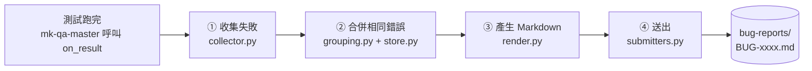

# mk-qa-bug-reporter

mk-qa-master 的插件：測試跑完後，把每個失敗的測試整理成一份 Markdown bug report，存到 `bug-reports/` 資料夾。**相同的錯誤只會有一份報告**，不會重複開。

這份文件寫給程式初學者，分成五部分：

1. [怎麼安裝和使用](#1-安裝和使用)
2. [它是怎麼運作的](#2-它是怎麼運作的)
3. [每個檔案在做什麼](#3-每個檔案在做什麼)
4. [我想改報告的長相，要改哪裡？](#4-我想改報告的長相要改哪裡)
5. [以後要加 Jira，要改哪裡？](#5-以後要加-jira要改哪裡)

---

## 1. 安裝和使用

### 安裝

把插件裝進**和 mk-qa-master 同一個 Python 環境**：

```bash
pip install -e plugins/mk-qa-bug-reporter
```

裝好就生效，不需要改 mk-qa-master 的任何檔案或設定。

### 使用

照平常的方式請 AI 跑測試（也就是讓它呼叫 MCP 工具 `run_tests` 或 `run_failed`）。有測試失敗時：

- 受測專案（`QA_PROJECT_ROOT`）底下會出現 `bug-reports/BUG-xxxxxxxx.md`
- AI 收到的回應會多一段 `result_hooks`，告訴它產生了幾份報告、放在哪

> **注意：** 只有透過 MCP 的 `run_tests` / `run_failed` 才會觸發。自己在終端機直接打 `pytest` **不會**產生報告，因為這個插件是掛在 MCP 工具上的。

### 確認插件有被載入

請 AI 呼叫 `get_runner_info`，回應裡應該看到：

```json
"plugins": {
  "enabled": true,
  "loaded": [{"group": "mk_qa_master.result_hooks", "name": "bug_reporter", ...}],
  "errors": []
}
```

### 設定（都是選用的環境變數）

| 環境變數 | 預設值 | 用途 |
|---|---|---|
| `QA_BUG_REPORT_SEVERITY` | `Medium` | 每份報告的預設嚴重度 |
| `QA_BUG_REPORT_DIR` | `<受測專案>/bug-reports` | 報告存放的資料夾 |
| `QA_BUG_REPORT_SUBMITTERS` | `file` | 送出管道，用逗號分隔。目前只有 `file` |
| `QA_BUG_REPORT_ENABLED` | `1` | 設成 `0` 可暫時關閉這個插件 |

把它們加在 MCP 設定的 `env` 區塊裡，和 `QA_RUNNER`、`QA_PROJECT_ROOT` 放一起。

### 自己試一次

`examples/` 裡有一個故意會失敗的範例專案和一支示範腳本：

```bash
# 把範例複製到別處再跑，避免在 repo 裡留下測試產物
cp -r plugins/mk-qa-bug-reporter/examples/failing_project /tmp/demo
python plugins/mk-qa-bug-reporter/examples/demo_via_mcp.py /tmp/demo
```

腳本會啟動一個真正的 MCP server、呼叫 `run_tests`，最後列出 `bug-reports/` 的檔案。範例有 4 個測試：2 個因同一個錯誤失敗、1 個因另一個錯誤失敗、1 個通過，所以會產生 **2 份**報告。需要先裝好 Playwright 的 chromium（`playwright install chromium`）。

再跑第二次，檔案仍然是 2 份，但每份的「出現次數」會變成 2，AI 收到的回應會是 `"new": 0, "updated": 2`。

**在 Windows 上請加 `--isolate-stdin`**（原因見下方「Windows 注意事項」）：

```bash
python plugins/mk-qa-bug-reporter/examples/demo_via_mcp.py <資料夾> --isolate-stdin
```

產生的報告大致長這樣（節錄）：

```markdown
# [test_login_with_password[chromium]] playwright._impl._errors.TimeoutError: Locator.click: Timeout 1000ms exceeded.（共 2 個測試）

| 欄位 | 內容 |
|---|---|
| Bug ID | BUG-2ecf864b |
| 嚴重度 | Medium |
| 出現次數 | 1 次（首次 2026-11-17T13:31:46，最近 2026-11-17T13:31:46） |
| 受影響測試數 | 2 |

## 環境
## 重現步驟
## 預期結果
## 實際結果
## 錯誤訊息
## 截圖／Trace／影片
## 受影響的測試
```

### Windows 注意事項

開發這個插件時，在 Windows 11 + mk-qa-master 1.5.0 上遇到一個**和本插件無關、屬於 mk-qa-master 本身**的狀況：

- **現象：** 透過 MCP（stdio）呼叫 `run_tests` 時，pytest 子行程啟動後卡住不動，`run_tests` 一直不回應。同樣的測試直接在終端機用 `pytest` 跑，6 秒就結束。
- **原因（已用對照實驗確認）：** mk-qa-master 啟動 pytest 時沒有指定 stdin，子行程因此繼承了 MCP server 的 stdin 管線。只要把子行程的 stdin 改成 `DEVNULL`，`run_tests` 就能正常完成。
- **影響：** `run_tests` 沒有回應，自然也不會呼叫本插件，所以不會有報告。
- **示範腳本的處理：** `--isolate-stdin` 會用一小段包裝程式啟動 server，只把 `subprocess.run` 的 stdin 預設成 `DEVNULL`，不修改 mk-qa-master 的任何檔案。
- **尚未確認的部分：** 這是用示範腳本裡的 Python MCP client 測到的。Claude Desktop、Cursor 等實際的 AI 客戶端在 Windows 上是否也會卡住，沒有測過。如果你在那些客戶端遇到 `run_tests` 沒有回應，很可能是同一個原因，需要在 mk-qa-master 那邊修（`src/mk_qa_master/security.py` 的 `safe_run()`）。

### 跑插件自己的測試

```bash
cd plugins/mk-qa-bug-reporter
pytest tests
```

---

## 2. 它是怎麼運作的



### 「相同錯誤」是怎麼判斷的？

1. 從錯誤訊息裡挑出真正在描述錯誤的那幾行。
2. 把每次執行都會變的東西抹掉：行號、記憶體位址、重試次數、頁面內容快照。
3. 對剩下的文字算一個雜湊值，叫做**指紋**。指紋相同就當成同一個 bug。

指紋也是檔名的一部分（`BUG-<指紋>.md`），所以同一個 bug 永遠寫到同一個檔案。

`bug-reports/.index.json` 記錄每個指紋的歷史：第一次出現的時間、出現過幾次、影響過哪些測試。下次同一個錯誤再出現時，報告會被**更新**（出現次數 +1），而不是另開一份。

### 已知限制

- **兩個不同的 bug 若錯誤訊息一樣，會被併成一份。** 例如兩個不同的頁面都逾時、訊息文字剛好相同。所以每份報告都會列出所有受影響的測試，方便人工判斷要不要拆開。
- **附件有多完整，看 runner。** pytest + Playwright 會有截圖、trace、影片路徑；jest 只提供錯誤訊息，報告裡附件會顯示「無」。
- **「預期結果」來自測試的 docstring。** 測試沒寫 docstring 時，只能寫出「測試應通過」這種通用句。
- **bug 修好後報告不會自動關閉或刪除。** 檔案會留著，要手動清。
- **嚴重度沒有判斷規則。** 全部都是同一個預設值，需要人工調整。

---

## 3. 每個檔案在做什麼

```
plugins/mk-qa-bug-reporter/
├── pyproject.toml              套件設定 + 向 mk-qa-master 登記入口
├── README.md                   這份文件
├── mk_qa_bug_reporter/
│   ├── hook.py                 入口，把四個步驟串起來
│   ├── collector.py            ① 收集失敗的測試
│   ├── grouping.py             ② 算指紋、合併相同錯誤
│   ├── store.py                ② 歷史紀錄（.index.json）
│   ├── render.py               ③ 產生 Markdown  ← 改長相看這裡
│   ├── submitters.py           ④ 送出報告       ← 加 Jira 看這裡
│   ├── models.py               資料結構
│   └── settings.py             讀環境變數
├── tests/                      插件的單元測試
└── examples/                   故意失敗的範例 + 示範腳本
```

| 檔案 | 白話說明 |
|---|---|
| `pyproject.toml` | 最重要的是 `[project.entry-points."mk_qa_master.result_hooks"]` 這一段。它是一張「登記表」，告訴 mk-qa-master：測試跑完請呼叫 `mk_qa_bug_reporter.hook` 裡的 `on_result`。 |
| `hook.py` | **入口。** `on_result(event)` 被 mk-qa-master 呼叫，真正的流程在 `process()`：讀設定 → 收集 → 合併 → 產生文字 → 送出 → 回報結果。想知道整體流程，先讀這個檔案。 |
| `collector.py` | **步驟 ①。** 向目前的 runner 要「哪些測試失敗了」。mk-qa-master 給插件的 `event` 裡沒有失敗明細，所以要自己去拿。 |
| `grouping.py` | **步驟 ②。** `normalize_error()` 把錯誤訊息整理成穩定的文字，`fingerprint_of()` 算指紋，`group_failures()` 把指紋相同的失敗放在一起。`summarize_error()` 產生一行摘要。 |
| `store.py` | **步驟 ② 的記憶。** 讀寫 `.index.json`，負責「這個 bug 以前出現過嗎？第幾次了？」。 |
| `render.py` | **步驟 ③。** 把一份 bug 的資料變成 Markdown 文字。報告的標題、段落、文字都在這裡決定。 |
| `submitters.py` | **步驟 ④。** `Submitter` 是「送出管道」的共同介面，`FileSubmitter` 是今天唯一的實作（存成檔案）。 |
| `models.py` | 定義三種資料：`Failure`（一個失敗的測試）、`BugReport`（一份報告）、`SubmitResult`（送出的結果）。其他檔案都用這些型別傳資料。 |
| `settings.py` | 讀上面那四個環境變數，整理成一個 `Settings` 物件。 |

---

## 4. 我想改報告的長相，要改哪裡？

**幾乎都只改 `mk_qa_bug_reporter/render.py`。** 改完不用重新安裝（因為是用 `pip install -e` 裝的），但要**重新啟動 MCP server**（重開 AI 客戶端）才會生效。

| 我想… | 改 `render.py` 的哪裡 |
|---|---|
| 把「重現步驟」改叫「Steps to Reproduce」，或把整份報告改成英文 | 檔案上方的 `LABELS` 字典，改冒號右邊的文字 |
| 改「環境」段落裡每一項的名稱（例如「作業系統」→「OS」） | `ENVIRONMENT_LABELS` 字典 |
| 調整段落順序，或拿掉某個段落 | `SECTION_ORDER` 清單。調換順序就是調換段落；刪掉一項，該段落就消失 |
| 改標題格式（例如前面加 `[QA]`） | `render_title()` 函式 |
| 改最上面那張摘要表的欄位 | `_section_summary()` 函式裡的 `rows` |
| 改「重現步驟」的寫法 | `_section_steps()` 與 `_rerun_instruction()` |
| 改「預期結果」的句子 | `_section_expected()` |
| 改「實際結果」的句子 | `_section_actual()` |
| 改錯誤訊息保留的長度 | `MAX_ERROR_CHARS`（預設 6000 個字元，保留尾段） |
| 改附件的排版 | `_section_attachments()` |
| 新增一個全新的段落 | 寫一個新的 `_section_xxx(report)` 函式 → 加進 `_SECTIONS` 字典 → 把名稱加進 `SECTION_ORDER` |

不在 `render.py` 的幾項：

| 我想… | 改哪裡 |
|---|---|
| 改預設嚴重度 | 不用改程式，設環境變數 `QA_BUG_REPORT_SEVERITY` |
| 在「環境」段落多放一項資料（例如瀏覽器） | 先在 `hook.py` 的 `build_environment()` 加資料，再到 `render.py` 的 `ENVIRONMENT_LABELS` 加對應的名稱 |
| 改檔名規則 | `grouping.py` 的 `group_failures()`（`bug_id=f"BUG-{fingerprint}"`）與 `submitters.py` 的 `FileSubmitter.submit()` |
| 讓合併更寬鬆或更嚴格 | `grouping.py` 的 `normalize_error()`。抹掉越多東西，越容易被判成同一個 bug |

**改完記得跑測試**（`pytest tests`）。`tests/test_bugreporter_units.py` 會檢查報告裡有沒有特定文字，改了 `LABELS` 之後有些測試會失敗，這是正常的，把測試裡對應的文字一起改掉即可。

### 小練習：把嚴重度那一列改成紅色警示

打開 `render.py`，找到 `_section_summary()` 裡的這一行：

```python
(LABELS["severity"], report.severity),
```

改成：

```python
(LABELS["severity"], f"🔴 {report.severity}"),
```

存檔、重啟 MCP server、再跑一次會失敗的測試，就會看到變化。

---

## 5. 以後要加 Jira，要改哪裡？

今天**沒有**實作 Jira，但介面已經留好。只需要動 `submitters.py`：

1. 新增一個類別，繼承 `Submitter`，實作 `submit(report, markdown)`：

   ```python
   class JiraSubmitter(Submitter):
       name = "jira"

       def submit(self, report: BugReport, markdown: str) -> SubmitResult:
           existing = report.refs.get("jira")       # 這個 bug 之前開過的單號
           if existing:
               ...  # 在既有的單上留言或更新
               return SubmitResult(ok=True, ref=existing)
           ...      # 開新單：Summary 用 report.title，Description 用 markdown
           return SubmitResult(ok=True, ref="QA-123")
   ```

2. 在檔案最下面的 `SUBMITTERS` 字典登記：`"jira": JiraSubmitter`

3. 設環境變數 `QA_BUG_REPORT_SUBMITTERS=file,jira`

`submit()` 回傳的 `ref`（例如單號 `QA-123`）會被存進 `.index.json`。下次同一個 bug 再出現，就能從 `report.refs["jira"]` 取回，用來「更新同一張單」而不是「重開一張」。收集、合併、產生 Markdown 這三步完全不用改。

Jira 的網址和金鑰請從環境變數讀（可覆寫 `from_settings()`），不要寫在程式裡。

> **關於格式：** 報告是標準 Markdown，貼進 Jira Cloud 的新版編輯器會自動轉換。若之後改用 API 送出，Jira 的 API 不直接吃 Markdown（Cloud 用 ADF、Server 用 wiki 語法），屆時需要在 `JiraSubmitter` 裡做轉換，或在 `render.py` 加一個對應的輸出格式。
