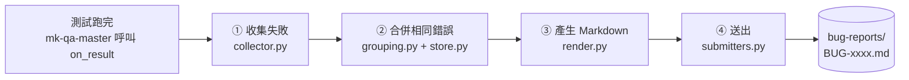

# mk-qa-bug-reporter

mk-qa-master 的插件：測試跑完後，把每個失敗的測試整理成一份 Markdown bug report，存到 `bug-reports/` 資料夾。**相同的錯誤只會有一份報告**，不會重複開。

這份文件寫給程式初學者，分成六部分：

1. [怎麼安裝和使用](#1-安裝和使用)
2. [它是怎麼運作的](#2-它是怎麼運作的)
3. [每個檔案在做什麼](#3-每個檔案在做什麼)
4. [我想改報告的長相，要改哪裡？](#4-我想改報告的長相要改哪裡)
5. [送到 Jira（選用）](#5-送到-jira選用)
6. [想再接別的系統，要改哪裡？](#6-想再接別的系統要改哪裡)

---

## 1. 安裝和使用

### 安裝

把插件裝進**和 mk-qa-master 同一個 Python 環境**：

```bash
pip install -e plugins/mk-qa-bug-reporter
```

裝好就生效，不需要改 mk-qa-master 的任何檔案或設定。

### 使用

照平常的方式請 AI 跑測試（也就是讓它呼叫 MCP 工具 `run_tests` 或 `run_failed`）。有測試失敗時：

- 受測專案（`QA_PROJECT_ROOT`）底下會出現 `bug-reports/BUG-xxxxxxxx.md`
- AI 收到的回應會多一段 `result_hooks`，告訴它產生了幾份報告、放在哪

> **注意：** 只有透過 MCP 的 `run_tests` / `run_failed` 才會觸發。自己在終端機直接打 `pytest` **不會**產生報告，因為這個插件是掛在 MCP 工具上的。

### 確認插件有被載入

請 AI 呼叫 `get_runner_info`，回應裡應該看到：

```json
"plugins": {
  "enabled": true,
  "loaded": [{"group": "mk_qa_master.result_hooks", "name": "bug_reporter", ...}],
  "errors": []
}
```

### 設定（都是選用的環境變數）

| 環境變數 | 預設值 | 用途 |
|---|---|---|
| `QA_BUG_REPORT_SEVERITY` | `Medium` | 每份報告的預設嚴重度 |
| `QA_BUG_REPORT_DIR` | `<受測專案>/bug-reports` | 報告存放的資料夾 |
| `QA_BUG_REPORT_SUBMITTERS` | `file` | 送出管道，用逗號分隔。可用 `file`（存成檔案）與 `jira`（見[第 5 節](#5-送到-jira選用)） |
| `QA_BUG_REPORT_ENABLED` | `1` | 設成 `0` 可暫時關閉這個插件 |

把它們加在 MCP 設定的 `env` 區塊裡，和 `QA_RUNNER`、`QA_PROJECT_ROOT` 放一起。

### 自己試一次

`examples/` 裡有一個故意會失敗的範例專案和一支示範腳本：

```bash
# 把範例複製到別處再跑，避免在 repo 裡留下測試產物
cp -r plugins/mk-qa-bug-reporter/examples/failing_project /tmp/demo
python plugins/mk-qa-bug-reporter/examples/demo_via_mcp.py /tmp/demo
```

腳本會啟動一個真正的 MCP server、呼叫 `run_tests`，最後列出 `bug-reports/` 的檔案。範例有 4 個測試：2 個因同一個錯誤失敗、1 個因另一個錯誤失敗、1 個通過，所以會產生 **2 份**報告。需要先裝好 Playwright 的 chromium（`playwright install chromium`）。

再跑第二次，檔案仍然是 2 份，但每份的「出現次數」會變成 2，AI 收到的回應會是 `"new": 0, "updated": 2`。

**在 Windows 上請加 `--isolate-stdin`**（原因見下方「Windows 注意事項」）：

```bash
python plugins/mk-qa-bug-reporter/examples/demo_via_mcp.py <資料夾> --isolate-stdin
```

完整的範例輸出放在 [`examples/sample_output/`](examples/sample_output/)，是跑完兩次後實際產生的兩份報告（路徑已換成示意用的 `C:\path\to\your-project`）。

產生的報告大致長這樣（節錄）：

```markdown
# [test_login_with_password[chromium]] playwright._impl._errors.TimeoutError: Locator.click: Timeout 1000ms exceeded.（共 2 個測試）

| 欄位 | 內容 |
|---|---|
| Bug ID | BUG-2ecf864b |
| 嚴重度 | Medium |
| 出現次數 | 1 次（首次 2026-11-17T13:31:46，最近 2026-11-17T13:31:46） |
| 受影響測試數 | 2 |

## 環境
## 重現步驟
## 預期結果
## 實際結果
## 錯誤訊息
## 截圖／Trace／影片
## 受影響的測試
```

### Windows 注意事項

開發這個插件時，在 Windows 11 + mk-qa-master 1.5.0 上遇到一個**和本插件無關、屬於 mk-qa-master 本身**的狀況（完整報告：[`docs/bug-reports/windows-run-tests-stdin-hang.md`](../../docs/bug-reports/windows-run-tests-stdin-hang.md)）：

- **現象：** 透過 MCP（stdio）呼叫 `run_tests` 時，pytest 子行程啟動後卡住不動，`run_tests` 一直不回應。同樣的測試直接在終端機用 `pytest` 跑，6 秒就結束。
- **原因（已用對照實驗確認）：** mk-qa-master 啟動 pytest 時沒有指定 stdin，子行程因此繼承了 MCP server 的 stdin 管線。只要把子行程的 stdin 改成 `DEVNULL`，`run_tests` 就能正常完成。
- **影響：** `run_tests` 沒有回應，自然也不會呼叫本插件，所以不會有報告。
- **示範腳本的處理：** `--isolate-stdin` 會用一小段包裝程式啟動 server，只把 `subprocess.run` 的 stdin 預設成 `DEVNULL`，不修改 mk-qa-master 的任何檔案。
- **尚未確認的部分：** 這是用示範腳本裡的 Python MCP client 測到的。Claude Desktop、Cursor 等實際的 AI 客戶端在 Windows 上是否也會卡住，沒有測過。如果你在那些客戶端遇到 `run_tests` 沒有回應，很可能是同一個原因，需要在 mk-qa-master 那邊修（`src/mk_qa_master/security.py` 的 `safe_run()`）。

### 跑插件自己的測試

```bash
cd plugins/mk-qa-bug-reporter
pytest tests
```

---

## 2. 它是怎麼運作的



### 「相同錯誤」是怎麼判斷的？

1. 從錯誤訊息裡挑出真正在描述錯誤的那幾行。
2. 把每次執行都會變的東西抹掉：行號、記憶體位址、重試次數、頁面內容快照。
3. 對剩下的文字算一個雜湊值，叫做**指紋**。指紋相同就當成同一個 bug。

指紋也是檔名的一部分（`BUG-<指紋>.md`），所以同一個 bug 永遠寫到同一個檔案。

### 用手機模擬跑測試時（多個裝置）

如果測試名稱後面帶有裝置（例如 `test_x[iPhone 15-chromium]`，做法見 [`examples/mobile-h5/`](../../examples/mobile-h5/)），插件會多做兩件事：

- **報告會標出裝置。**「環境」段落多一行「裝置」，最上面的摘要表多一列「受影響裝置」。測試沒有帶裝置時，這兩處都不會出現。
- **同一個測試在不同裝置上以同一種錯誤失敗，只開一份報告。** 不同手機量到的數字通常不一樣（例如 `assert 800 <= 393` 與 `assert 801 <= 412`），所以比對這種情況時會額外忽略數字和裝置名稱。報告裡會列出所有受影響的裝置、各自的重跑指令，以及各裝置不同的那幾行錯誤。

「忽略數字」只用在**同一個測試**跨裝置的比對。不同的測試即使錯誤只差在數字，仍然分開，避免把不相干的問題併在一起。

哪些名稱算裝置，由 `devices.py` 的 `DEVICE_PREFIXES` 決定（iPhone、iPad、Pixel、Galaxy、Desktop 等 Playwright 內建裝置的開頭）。用了自訂的裝置名稱，把開頭加進去即可。

範例輸出：[`examples/sample_output/BUG-3b0a6fd8.md`](examples/sample_output/BUG-3b0a6fd8.md)。

### 歷史紀錄

`bug-reports/.index.json` 記錄每個指紋的歷史：第一次出現的時間、出現過幾次、影響過哪些測試。下次同一個錯誤再出現時，報告會被**更新**（出現次數 +1），而不是另開一份。

### 已知限制

- **帶裝置的測試，錯誤訊息含數字時不會跨測試合併。** 例如兩個不同的測試在手機上都出現 `Timeout 1000ms exceeded`，會各開一份（每份各自涵蓋所有裝置）。這是為了不因為「忽略數字」而誤併不同的問題所做的取捨；沒有帶裝置的測試不受影響，仍然會合併。
- **兩個不同的 bug 若錯誤訊息一樣，會被併成一份。** 例如兩個不同的頁面都逾時、訊息文字剛好相同。所以每份報告都會列出所有受影響的測試，方便人工判斷要不要拆開。
- **附件有多完整，看 runner。** pytest + Playwright 會有截圖、trace、影片路徑；jest 只提供錯誤訊息，報告裡附件會顯示「無」。
- **「預期結果」來自測試的 docstring。** 測試沒寫 docstring 時，只能寫出「測試應通過」這種通用句。
- **bug 修好後報告不會自動關閉或刪除。** 檔案會留著，要手動清。
- **嚴重度沒有判斷規則。** 全部都是同一個預設值，需要人工調整。

---

## 3. 每個檔案在做什麼

```
plugins/mk-qa-bug-reporter/
├── pyproject.toml              套件設定 + 向 mk-qa-master 登記入口
├── README.md                   這份文件
├── mk_qa_bug_reporter/
│   ├── hook.py                 入口，把四個步驟串起來
│   ├── collector.py            ① 收集失敗的測試
│   ├── grouping.py             ② 算指紋、合併相同錯誤
│   ├── devices.py              ② 從測試名稱辨識裝置
│   ├── store.py                ② 歷史紀錄（.index.json）
│   ├── render.py               ③ 產生 Markdown  ← 改長相看這裡
│   ├── submitters.py           ④ 送出管道的登記表 + 存成檔案
│   ├── base.py                 ④ 送出管道的共同介面
│   ├── jira.py                 ④ 送到 Jira
│   ├── adf.py                  ④ 把 Markdown 轉成 Jira 的格式
│   ├── models.py               資料結構
│   └── settings.py             讀環境變數
├── tests/                      插件的單元測試
└── examples/                   故意失敗的範例 + 示範腳本
```

| 檔案 | 白話說明 |
|---|---|
| `pyproject.toml` | 最重要的是 `[project.entry-points."mk_qa_master.result_hooks"]` 這一段。它是一張「登記表」，告訴 mk-qa-master：測試跑完請呼叫 `mk_qa_bug_reporter.hook` 裡的 `on_result`。 |
| `hook.py` | **入口。** `on_result(event)` 被 mk-qa-master 呼叫，真正的流程在 `process()`：讀設定 → 收集 → 合併 → 產生文字 → 送出 → 回報結果。想知道整體流程，先讀這個檔案。 |
| `collector.py` | **步驟 ①。** 向目前的 runner 要「哪些測試失敗了」。mk-qa-master 給插件的 `event` 裡沒有失敗明細，所以要自己去拿。 |
| `grouping.py` | **步驟 ②。** `normalize_error()` 把錯誤訊息整理成穩定的文字，`fingerprint_of()` 算指紋，`group_failures()` 把指紋相同的失敗放在一起。`summarize_error()` 產生一行摘要。 |
| `devices.py` | **步驟 ② 的小幫手。** 把 `test_x[iPhone 15-chromium]` 拆成「裝置 iPhone 15」和「測試 `test_x[chromium]`」。哪些字算裝置，看檔案裡的 `DEVICE_PREFIXES`。 |
| `store.py` | **步驟 ② 的記憶。** 讀寫 `.index.json`，負責「這個 bug 以前出現過嗎？第幾次了？」。 |
| `render.py` | **步驟 ③。** 把一份 bug 的資料變成 Markdown 文字。報告的標題、段落、文字都在這裡決定。 |
| `submitters.py` | **步驟 ④。** 最下面的 `SUBMITTERS` 是送出管道的登記表（`file`、`jira`）。`FileSubmitter`（存成檔案）也寫在這裡。 |
| `base.py` | **步驟 ④。** `Submitter`：所有送出管道都要遵守的共同介面，只規定一件事——要有一個 `submit(report, markdown)`。 |
| `jira.py` | **步驟 ④。** `JiraSubmitter`：第一次出現就建立 Jira issue，再次出現就在原本的 issue 留言。讀 Jira 相關的環境變數、負責把 API token 從所有輸出中遮掉。 |
| `adf.py` | **步驟 ④ 的小幫手。** Jira 不直接接受 Markdown，這個檔案把報告轉成 Jira 要的格式（ADF）。 |
| `models.py` | 定義三種資料：`Failure`（一個失敗的測試）、`BugReport`（一份報告）、`SubmitResult`（送出的結果）。其他檔案都用這些型別傳資料。 |
| `settings.py` | 讀上面那四個環境變數，整理成一個 `Settings` 物件。 |

---

## 4. 我想改報告的長相，要改哪裡？

**幾乎都只改 `mk_qa_bug_reporter/render.py`。** 改完不用重新安裝（因為是用 `pip install -e` 裝的），但要**重新啟動 MCP server**（重開 AI 客戶端）才會生效。

| 我想… | 改 `render.py` 的哪裡 |
|---|---|
| 把「重現步驟」改叫「Steps to Reproduce」，或把整份報告改成英文 | 檔案上方的 `LABELS` 字典，改冒號右邊的文字 |
| 改「環境」段落裡每一項的名稱（例如「作業系統」→「OS」） | `ENVIRONMENT_LABELS` 字典 |
| 調整段落順序，或拿掉某個段落 | `SECTION_ORDER` 清單。調換順序就是調換段落；刪掉一項，該段落就消失 |
| 改標題格式（例如前面加 `[QA]`） | `render_title()` 函式 |
| 改最上面那張摘要表的欄位 | `_section_summary()` 函式裡的 `rows` |
| 改「重現步驟」的寫法 | `_section_steps()` 與 `_rerun_instruction()` |
| 改「預期結果」的句子 | `_section_expected()` |
| 改「實際結果」的句子 | `_section_actual()` |
| 改錯誤訊息保留的長度 | `MAX_ERROR_CHARS`（預設 6000 個字元，保留尾段） |
| 改附件的排版 | `_section_attachments()` |
| 新增一個全新的段落 | 寫一個新的 `_section_xxx(report)` 函式 → 加進 `_SECTIONS` 字典 → 把名稱加進 `SECTION_ORDER` |

不在 `render.py` 的幾項：

| 我想… | 改哪裡 |
|---|---|
| 改預設嚴重度 | 不用改程式，設環境變數 `QA_BUG_REPORT_SEVERITY` |
| 在「環境」段落多放一項資料（例如瀏覽器） | 先在 `hook.py` 的 `build_environment()` 加資料，再到 `render.py` 的 `ENVIRONMENT_LABELS` 加對應的名稱 |
| 改檔名規則 | `grouping.py` 的 `group_failures()`（`bug_id=f"BUG-{fingerprint}"`）與 `submitters.py` 的 `FileSubmitter.submit()` |
| 讓合併更寬鬆或更嚴格 | `grouping.py` 的 `normalize_error()`。抹掉越多東西，越容易被判成同一個 bug。跨裝置的比對規則在同檔的 `loosen_for_devices()` 與 `fingerprint_of()` |
| 讓某個自訂名稱被認成裝置 | `devices.py` 的 `DEVICE_PREFIXES` |
| 改多個裝置之間的分隔符號 | `render.py` 的 `DEVICE_SEPARATOR` |

**改完記得跑測試**（`pytest tests`）。`tests/test_bugreporter_units.py` 會檢查報告裡有沒有特定文字，改了 `LABELS` 之後有些測試會失敗，這是正常的，把測試裡對應的文字一起改掉即可。

### 小練習：把嚴重度那一列改成紅色警示

打開 `render.py`，找到 `_section_summary()` 裡的這一行：

```python
(LABELS["severity"], report.severity),
```

改成：

```python
(LABELS["severity"], f"🔴 {report.severity}"),
```

存檔、重啟 MCP server、再跑一次會失敗的測試，就會看到變化。

---

## 5. 送到 Jira（選用）

預設情況下，報告只會存成檔案。開啟這個功能後，插件會另外把報告送到 **Jira Cloud**：

- 某個 bug **第一次**出現 → 自動開一張 issue。
- 同一個 bug **再次**出現 → 在原本那張 issue 加一則留言（寫明第幾次、哪些測試、哪些裝置），**不會重複開單**。
- Jira 連不上或回傳錯誤 → 測試照常完成、檔案報告照常產生，並記下哪一份沒送成功，下次會自動補送。

> **請先知道：這個功能沒有對真正的 Jira 測試過。** 開發時沒有 Jira 帳號，所有測試都是用「假的 Jira」完成的（細節見[驗證到什麼程度](#驗證到什麼程度)）。第一次使用請務必照下面的順序，先用 dry-run 試。

整個流程分四步，請依序做：

1. [在 Jira 取得 API token](#步驟一在-jira-取得-api-token)
2. [在 PowerShell 設定環境變數](#步驟二在-powershell-設定環境變數)
3. [先用 dry-run 試](#步驟三先用-dry-run-試)
4. [正式啟用](#步驟四正式啟用)

### 步驟一：在 Jira 取得 API token

API token 是一串很長的文字，作用等於「讓程式代替你登入 Jira 的密碼」。它**不是**你平常登入用的密碼。

1. 用瀏覽器登入你的 Atlassian 帳號，打開：<https://id.atlassian.com/manage-profile/security/api-tokens>
2. 按 **Create API token**（建立 API 權杖）。
   - 如果畫面上有兩個按鈕，請選**沒有** “with scopes” 字樣的那一個。有 scopes 的那種 token 要用不同的網址連線，這個插件不支援。
3. 取一個看得懂的名字（例如 `mk-qa-bug-reporter`），選一個到期日，按建立。
4. 畫面會顯示 token，**只會顯示這一次**。先不要關掉這個頁面，下一步馬上會用到。

另外準備三項資料：

| 資料 | 去哪裡找 | 範例 |
|---|---|---|
| Jira 網址 | 你平常開 Jira 時瀏覽器網址列的最前面 | `https://your-team.atlassian.net` |
| 帳號 email | 你登入 Jira 用的 email | `you@example.com` |
| 專案代碼 | issue 編號前面的英文字。例如 issue 是 `QA-123`，代碼就是 `QA` | `QA` |

Atlassian 的網頁會改版，按鈕的文字和位置可能和這裡寫的略有不同。

#### token 的安全守則

- **不要**把 token 貼給 AI、貼在聊天室、寫在 email 或文件裡。
- **不要**把 token 寫進任何會放進 Git 的檔案。
- 懷疑外洩時，回到上面那個網頁按 **Revoke**（撤銷），再建一個新的。撤銷後舊的立刻失效。
- token 的權限等同於你的帳號：你能看、能改的 Jira 內容，拿到 token 的人也能。

### 步驟二：在 PowerShell 設定環境變數

「環境變數」是放在電腦裡、讓程式讀取的設定值。這個插件只從環境變數讀 Jira 的設定，不會把它們寫進任何檔案。

打開 **PowerShell**（開始功能表搜尋 PowerShell），把下面四行**一行一行**貼上執行。前三行請把引號裡的內容換成你自己的：

```powershell
$env:QA_BUG_REPORT_JIRA_URL = "https://your-team.atlassian.net"
$env:QA_BUG_REPORT_JIRA_EMAIL = "you@example.com"
$env:QA_BUG_REPORT_JIRA_PROJECT = "QA"
$env:QA_BUG_REPORT_SUBMITTERS = "file,jira"
```

最後一行的意思是「存成檔案，**並且**送到 Jira」。請保留 `file`，這樣 Jira 出問題時你手上仍有檔案報告。

接著設定 token。**不要**用上面那種寫法把 token 直接打在指令裡，因為 PowerShell 會把你打過的指令存進歷史紀錄檔。請改用下面兩行：

```powershell
$secure = Read-Host "請貼上 API token 後按 Enter" -AsSecureString
$env:QA_BUG_REPORT_JIRA_API_TOKEN = [System.Net.NetworkCredential]::new("", $secure).Password
```

執行第一行後，畫面會等你輸入。把 token 貼上（畫面只會顯示星號或什麼都不顯示，這是正常的），按 Enter，再執行第二行。這樣 token 不會出現在畫面上，也不會進入指令歷史。

確認有設定成功（只顯示長度，不顯示內容）：

```powershell
$env:QA_BUG_REPORT_JIRA_API_TOKEN.Length
```

顯示一個大於 0 的數字就對了。

#### 這樣設定的效果與限制

- 這些設定**只存在於這一個 PowerShell 視窗**。關掉視窗就消失，下次要重新設定。這是最安全的方式。
- 只有**從這個視窗啟動**的程式讀得到。所以接下來的指令都要在同一個視窗裡執行。
- **透過 AI 客戶端使用時要注意：** 很多 AI 客戶端啟動 mk-qa-master 時，只會傳入它自己設定檔 `env` 區塊裡寫的變數，不會傳入你在 PowerShell 設的變數。各家做法不同，這一點沒有逐一驗證過。
  - 如果你的客戶端支援在設定檔裡「引用」環境變數（有些寫成 `${變數名稱}`），請用引用的方式，不要寫入實際的值。
  - 如果只能把值直接寫進客戶端的設定檔，那個檔案就會含有 token。這是客戶端的限制，不是這個插件寫進去的；請確認該檔案不在任何 Git 專案裡、不會被分享或備份到公開的地方。
  - 下面的步驟使用插件附的示範腳本，它會把這個視窗的環境變數完整傳給 mk-qa-master，所以不受這個問題影響。

#### 其他可調整的設定

| 環境變數 | 預設 | 說明 |
|---|---|---|
| `QA_BUG_REPORT_JIRA_ISSUE_TYPE` | `Bug` | 要建立的 issue 類型。名稱要和你們 Jira 專案裡的一模一樣；中文介面的 Jira 可能叫「錯誤」或其他名稱 |
| `QA_BUG_REPORT_JIRA_LABELS` | `mk-qa-bug-reporter` | 要加的標籤，逗號分隔。另外會自動加一個 `bug-<指紋>`。設成 `none` 則完全不加標籤 |
| `QA_BUG_REPORT_JIRA_DRY_RUN` | 未設定 | 設成 `1` 就只預覽、不送出（見步驟三） |
| `QA_BUG_REPORT_JIRA_TIMEOUT` | `15` | 等 Jira 回應最多幾秒 |

### 步驟三：先用 dry-run 試

dry-run 的意思是「排練」：插件把要送給 Jira 的內容全部準備好，但**不連線、不送出**，只讓你看。Jira 上不會出現任何東西。

在同一個 PowerShell 視窗，先開啟 dry-run：

```powershell
$env:QA_BUG_REPORT_JIRA_DRY_RUN = "1"
```

然後跑一次會失敗的範例（在 mk-qa-master 的資料夾裡執行）：

```powershell
python plugins/mk-qa-bug-reporter/examples/demo_via_mcp.py examples/mobile-h5 --isolate-stdin
```

看兩個地方：

**一、畫面上的輸出。** 找到 `"jira"` 那一段，應該長這樣：

```json
"jira": {
  "ok": true,
  "ref": "",
  "detail": "dry-run：將在專案 QA 建立一張 Bug（沒有真的送出）",
  "dry_run": true,
  "action": "create_issue",
  "url": "https://your-team.atlassian.net/rest/api/3/issue",
  "auth": "帳號 yo***@example.com + API token（已隱藏）",
  "summary": "[test_no_horizontal_scroll[chromium]] AssertionError: ...（2 個裝置）",
  "labels": ["mk-qa-bug-reporter", "bug-3b0a6fd8"],
  "preview_file": "...\\bug-reports\\jira-dry-run\\BUG-3b0a6fd8.json"
}
```

請檢查：

- `url` 開頭是不是你的 Jira 網址。
- `detail` 裡的專案代碼和 issue 類型對不對。
- `auth` 顯示的帳號是不是你的（中間會被遮住）。token 永遠只會顯示「已隱藏」。
- 如果多了一項 `"problems"`，代表有設定漏掉了，裡面會寫是哪一個環境變數。dry-run 在設定不完整時也能執行，方便你先看結果。

**二、預覽檔。** 打開 `preview_file` 指到的那個檔案（在受測專案的 `bug-reports/jira-dry-run/` 裡）。裡面是將要送給 Jira 的完整內容，可以確認標題和內文是不是你要的。這個檔案不含 token。

dry-run 不會把 bug 記成「已經開過單」，所以排練幾次都沒關係，不影響之後正式開單。

### 步驟四：正式啟用

dry-run 的結果都正確之後，在同一個 PowerShell 視窗關掉 dry-run：

```powershell
Remove-Item Env:QA_BUG_REPORT_JIRA_DRY_RUN
```

再跑一次同樣的指令：

```powershell
python plugins/mk-qa-bug-reporter/examples/demo_via_mcp.py examples/mobile-h5 --isolate-stdin
```

成功的話，`"jira"` 那一段會變成：

```json
"jira": {
  "ok": true,
  "ref": "QA-123",
  "detail": "已建立 QA-123",
  "action": "created",
  "url": "https://your-team.atlassian.net/browse/QA-123"
}
```

打開 `url` 就能看到那張 issue。**建議第一次先用測試用的 Jira 專案**，確認內容沒問題再換成正式的專案。

再跑一次（同一個 bug 再次出現），會看到 `"action": "commented"`，`ref` 仍是同一個編號，Jira 上是多一則留言而不是多一張單。

要停用 Jira、只留檔案報告：

```powershell
$env:QA_BUG_REPORT_SUBMITTERS = "file"
```

### 沒送成功時怎麼看

Jira 出問題不會讓測試失敗，但會在三個地方留下紀錄：

1. **該筆報告的 `"jira"` 區塊**：`"ok": false`，加上 `"error"` 說明原因。
2. **輸出最外層的 `"submit_failures"`**：列出所有沒送成功的 Bug ID，一眼就能看到。
3. **`bug-reports/.index.json`**：每個 bug 的 `last_submit` 記著各管道最近一次的結果與時間。

沒送成功的 bug 不會被記成「已開單」，所以下次同一個 bug 再出現時，插件會自動再試一次開單。

常見的錯誤訊息：

| 訊息 | 可能原因 | 怎麼處理 |
|---|---|---|
| `Jira 設定不完整：尚未設定 QA_BUG_REPORT_JIRA_…` | 少設了某個環境變數，或換了新的 PowerShell 視窗 | 回到步驟二重新設定 |
| `必須以 https:// 開頭` | 網址寫成 `http://` 或漏了開頭 | 改成 `https://` 開頭 |
| `HTTP 401` | email 或 token 不對、token 過期或已撤銷 | 重新建立 token，再做一次步驟二 |
| `HTTP 403` | 這個帳號沒有在該專案開單或留言的權限 | 請 Jira 管理員開權限 |
| `HTTP 404` | 網址或專案代碼打錯 | 檢查步驟一的三項資料 |
| `HTTP 400 … issuetype` | 專案裡沒有叫 `Bug` 的類型 | 設定 `QA_BUG_REPORT_JIRA_ISSUE_TYPE` 為正確名稱 |
| `HTTP 400 … labels` | 專案的建立畫面沒有「標籤」欄位 | 設定 `QA_BUG_REPORT_JIRA_LABELS` 為 `none` |
| `HTTP 400 …（其他欄位名稱）` | 專案規定了其他必填欄位 | 目前不支援，見下方限制 |
| `連不上 Jira（…）` | 沒有網路、網址打錯、公司防火牆或 proxy 擋住 | 先用瀏覽器確認能開啟 Jira |

### 目前的限制

- **只支援 Jira Cloud**（網址是 `*.atlassian.net` 的那種）。公司自架的 Jira Server / Data Center 用的是另一套登入方式與格式，沒有支援。
- **不會上傳截圖、trace、影片。** issue 裡只有它們在你電腦上的路徑，需要的話請手動附加。
- **嚴重度不會對應到 Jira 的 Priority 欄位。** 嚴重度只寫在內文裡，因為每個 Jira 專案的優先級名稱不同，自動填容易失敗。
- **專案有其他必填欄位時無法開單。** 目前只會填專案、類型、標題、內文、標籤。
- **摘要表在 Jira 上會變成條列**，不是表格。其餘的標題、清單、程式碼區塊會保留樣式。
- **再次出現時的判斷只看本機的 `.index.json`。** 如果刪掉這個檔案或換一台電腦跑，插件不知道以前開過單，會重新開一張。若原本的 issue 在 Jira 上被刪除，插件會改開一張新的。
- **bug 修好後不會自動關閉 issue。**

### 驗證到什麼程度

開發這個功能時沒有 Jira 帳號，**沒有任何一行程式實際連過真正的 Jira**。

已經用自動化測試確認的（都在 `tests/test_bugreporter_jira.py`）：

- 用「假的 Jira」（程式裡模擬的回應）確認：第一次出現會開單、再次出現會留言而不重開、原 issue 不存在時改開新單、各種錯誤（401、403、400、502、連線失敗、逾時）都不會讓流程中斷、檔案報告照常產生、失敗有被記錄、dry-run 完全不連線。
- 用一個只在本機運作的假伺服器，確認程式實際送出的連線格式：網址路徑、登入標頭、內容是 JSON。
- 在各種情況下（包含故意讓錯誤訊息夾帶 token），確認 token 不會出現在回傳結果、錯誤訊息、`.index.json`、報告檔、dry-run 預覽檔裡。
- dry-run 模式透過 MCP 實際跑過一次（`examples/mobile-h5`），有產生預覽檔。

**沒有**確認的：

- 真正的 Jira 是否接受這個插件送出的內容格式。內容格式（ADF）是依 Atlassian 的公開規格寫的，但沒有被真的 Jira 驗收過。這是最可能在第一次實際使用時出問題的地方。
- 真正的 Jira 回傳的錯誤訊息，是否和測試裡假設的格式相同。
- 步驟一的網頁操作與按鈕名稱。
- 各家 AI 客戶端如何把環境變數傳給 mk-qa-master。

所以第一次正式啟用時，請用測試專案，並實際打開建立出來的 issue 檢查內容。

---

## 6. 想再接別的系統，要改哪裡？

Jira 是透過預留的「送出管道」介面加上去的，沒有動到收集、合併、產生 Markdown 這三步。要再接別的系統（例如 Slack、GitHub Issues），做法相同：

1. 新增一個檔案，寫一個繼承 `Submitter`（定義在 `base.py`）的類別，實作 `submit(report, markdown)`。可以參考 `jira.py`。
2. 在 `submitters.py` 最下面的 `SUBMITTERS` 字典登記一個名稱。
3. 在環境變數 `QA_BUG_REPORT_SUBMITTERS` 加上那個名稱。

`submit()` 回傳的 `ref`（例如單號）會被存進 `.index.json`。下次同一個 bug 再出現，就能從 `report.refs["你的名稱"]` 取回，用來「更新同一筆」而不是「重開一筆」。

金鑰一律從環境變數讀，不要寫在程式裡，也不要放進回傳的 `detail` 或 `info`。
